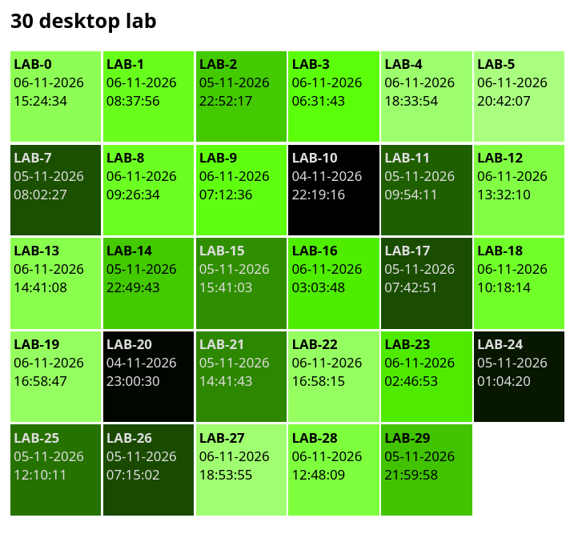

# pcmap

An experiment to make a coloured "map" of PCs in my university by their `lastlogon` time in Active Directory.



## Usage

To run the project you'll need:
- The names of domain controllers on your network
- A proper filter for computers
- Python with Jinja2 module installed

Use the PowerShell script `collect.ps1` to fetch data:

```powershell
.\collect.ps1 -OutputName "Classroom" -Servers DC1, DC2, ... -Filter "(objectClass=computer)"
```

Which will output JSON data to pipe into the Python script:

```jsonc
{
    "name": "Classroom",
    "values": {
        "LABPC01": 1793163153, // seconds since the Unix epoch
        "LABPC02": 1793143290,
        ...
    }
}
```

So essentially:

```powershell
.\collect.ps1 -OutputName "Classroom" -Servers DC1, DC2, ... -Filter "(objectClass=computer)" > data/out.json
python main.py data/out.json
```

The script will make an `out.html` file in the same directory. Enjoy!
