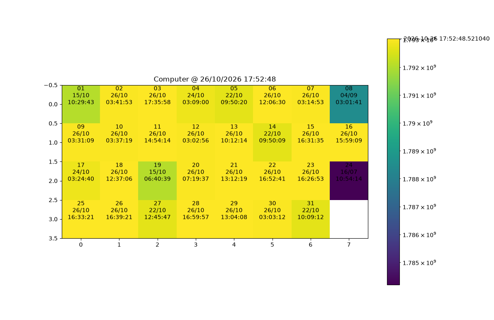

# pcmap

An experiment to make a coloured "map" of PCs in my university by their `lastlogon` time in Active Directory.



## Usage

To run the project you'll need:
- The names of two domain controllers on your network (my script doesn't really do more yet)
- A proper filter for computers
- matplotlib for Python

Use the PowerShell script `collect.ps1` to fetch data:

```powershell
.\collect.ps1 -Servers DC1, DC2, ... -Filter "(objectClass=computer)"
```

Which will output JSON data to pipe into the Python script:

```jsonc
{
    "LABPC01":  1793163153, // seconds since the Unix epoch
    "LABPC02":  1793143290,
    ...
}
```

So essentially:

```powershell
.\collect.ps1 -Servers DC1, DC2, ... -Filter "(objectClass=computer)" | python main.py
```

